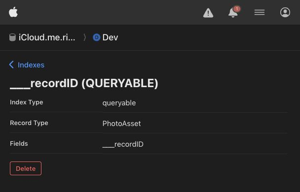

# Photo storage test results

Verified on 19 October 2026 using iPhone 18 Pro, iOS 27.0.

## Completed runs

| Run | Result |
| --- | --- |
| Storage, upload, cache, download, sync-status and deletion service regression tests | 125 passed, 0 failed |
| Empty-state link, storage-choice cancellation, settings order, Advanced navigation and reminder persistence UI checks | 4 passed, 0 failed |
| Live private CloudKit round trip, keeping existing cloud copies | Passed |
| Live private CloudKit round trip, deleting cloud copies after verifying local originals | Passed |
| Live one-record-page enumeration, unknown-record protection, metadata and asset removal, repeated deletion | Passed |
| Live rejection of a deletion plan targeting another zone | Passed |
| Live Core Data export, detached local edit, and resumed export under the same record identity | Passed |
| Read-only production-path library enumeration | Passed after adding the development query index |

Swift Testing groups parameterized cases under their test function. All 134 selected test functions have passed across the saved service, UI, and live runs. The live checks include five test functions. The round-trip function ran both keep/delete choices successfully.

## CloudKit configuration

The initial live enumeration exposed CloudKit error `invalidArguments`, server message `Field 'recordName' is not marked queryable`, for `iCloud.me.riepl.progress`. Full-library removal stopped safely at its preflight.

After developer sign-in, a **QUERYABLE** index for **PhotoAsset → recordName** (CloudKit system field `___recordID`) was added in **Development** through CloudKit Console. The previously failing enumeration passed against the signed-in simulator account afterward. Index creation preserves existing photo data.

This is one-time container schema configuration, shared by users of that environment. It can also be managed through `cktool` with a management token; this Mac had no token configured. Apple documents the system record-ID query index requirement and schema import/export in its [cktool guide](https://developer.apple.com/icloud/ck-tool/). Production deployment remains part of release preparation; verify this index in Production before shipping.

## Storage-status consistency regression

The running iPhone 18 Pro app was confirmed to have `SimulatorExamples.sqlite` open. That separate demo library always stays local, while the old toggle displayed the normal library's saved iCloud preference.

The simulator now identifies its example library, explains that sync is disabled for it, and displays the fixed local-only toggle as on and disabled. The normal library retains its saved preference. In the normal library, unavailable iCloud is reported separately from explicit local-only storage, with the actual reason visible in Settings and Photo Storage.

Regression cases verify unavailable/recovered accounts, explicit local-only mode, migration status precedence, simulator example status, and the actual example-library screen. The latest 125 service tests passed; four UI tests and five live CloudKit checks passed in the preceding runs.

## Storage-space estimates

The confirmation separates photo originals, peak extra working space for safe copies and library data, and the safety margin kept free on the device. Explicit storage switches use a margin of 10% of the working footprint, bounded between 50 MB and 500 MB. If no copies are needed, the estimate reports no extra storage requirement. Background offline caching keeps its separate 500 MB reserve.

For the reported five-photo example, 10.5 MB of originals plus the estimated library copy produces up to 27.8 MB of working space. The scaled margin is 50 MB, making the free-space threshold 77.8 MB. The former 527.8 MB figure included a fixed 500 MB margin; it was incorrectly labeled as additional download space.

The per-original check uses the same scaled margin as preflight. Regression cases cover its minimum, scaling, maximum, byte-overflow boundaries, and complete keep/delete-cloud-copy migrations with an injected 80 MB of free space.

## Scope and safety

All deterministic cases use unique temporary databases, journals, preferences and files. They cover empty libraries; missing/corrupt originals; unknown/low capacity; capacity exhaustion during download; account changes; authentication, quota and network failures; resumable downloads and multi-batch deletion; verification of actual absence after deletion; cancellation; blocked mutations and uploads during migration; local capture/import; repeated toggles; and durable upload ownership.

Live asset tests write only to unique `StorageTests-UUID` private zones and delete those exact zones afterward. The Core Data mirroring test uses a temporary database and edits/deletes only its own synthetic photo record. Existing account photos are never deletion targets. Cleanup completed without reported errors.

Restart cases reconstruct persistent components from disk. They do not force-kill an in-flight CloudKit process. Two-device races, real storage exhaustion, real quota exhaustion and actual account sign-out still require dedicated device testing. Movie fixtures exercise storage integrity for the motion-resource role, rather than Live Photo playback or decoding.

## Saved evidence

- Latest service regression (125 passed): `/Users/simonriepl/Library/Developer/XcodeBuildMCP/workspaces/progress-ba78d161c979/result-bundles/test_sim_2026-10-19T21-40-31-888Z_pid45480_5ade7312.xcresult`
- Latest UI tests (4 passed): `/Users/simonriepl/Library/Developer/XcodeBuildMCP/workspaces/progress-ba78d161c979/result-bundles/test_sim_2026-10-19T21-20-09-829Z_pid45480_5d9f8e8e.xcresult`
- Initial live CloudKit run (includes the original missing-index failure): `/Users/simonriepl/Library/Developer/XcodeBuildMCP/workspaces/progress-ba78d161c979/result-bundles/test_sim_2026-10-19T21-01-50-381Z_pid45480_d600f80b.xcresult`

- Live CloudKit rerun after configuring the index (4 passed): `/Users/simonriepl/Library/Developer/XcodeBuildMCP/workspaces/progress-ba78d161c979/result-bundles/test_sim_2026-10-19T21-10-24-935Z_pid45480_9eb35245.xcresult`

Run commands and opt-in environment variables are in the README's Photo storage switching section.
